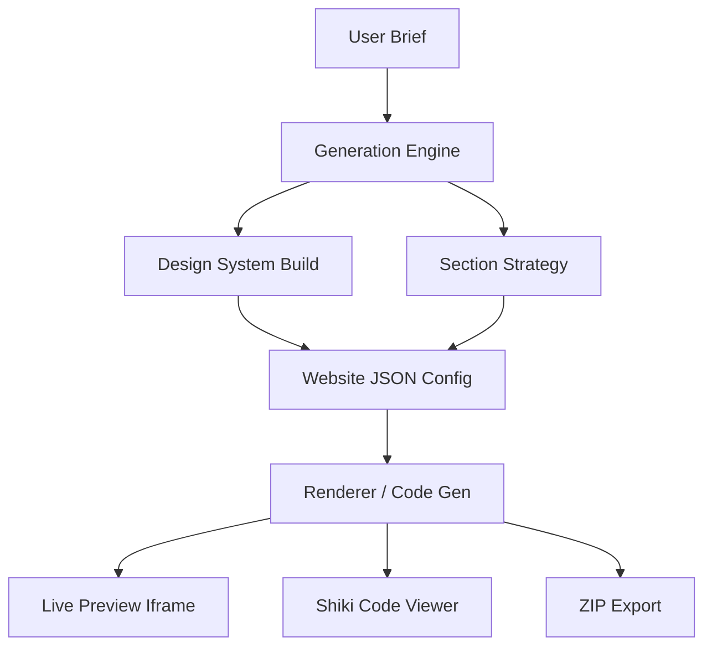

# Developer Documentation

Detailed documentation for the AI Website Generator architecture and implementation.

## Application Architecture

The app is built on **TanStack Start**, utilizing a full-stack React architecture. It follows a clear separation between the generator UI (React components) and the generation logic (deterministic engine).



## AI Generation Flow

1. **Understand**: The engine parses the user's prompt to determine `siteType` (e.g., SaaS, Restaurant), `visualStyle` (e.g., Futuristic, Minimal), and brand identity.
2. **Design System**: A `DesignSystem` object is created with specific OKLCH colors, fonts (Space Grotesk, Manrope, etc.), and UI tokens (radii, spacing).
3. **Plan**: A blueprint is selected based on the site type (e.g., Hero -> Features -> Pricing -> Footer).
4. **Build**: The engine populates each section with contextually relevant content and selects appropriate block templates from the registry.

## Website JSON Structure

The core state is a `WebsiteConfig` object:

```typescript
interface WebsiteConfig {
  name: string;
  description: string;
  designSystem: DesignSystem;
  sections: Section[];
}

interface Section {
  id: string;
  type: string;
  blockId: string; // ID from registry.ts
  content: Record<string, any>; // Text, images, list items
}
```

## Block Registry & Tailblocks Integration

Templates are stored in `src/lib/generator/blocks/registry.ts`.
- **Source**: Patterns are adapted from **Tailblocks** and custom designs.
- **Logic**: Markup uses semantic `.ds-*` classes (e.g., `.ds-btn`, `.ds-container`) instead of hardcoded Tailwind utility strings.
- **Dynamic Content**: Placeholders like `{{TITLE}}` or `{{ITEMS}}` are replaced by the renderer.

## Design System

The design system maps high-level visual styles to specific CSS variables:
- **Colors**: Obsidian base, Violet primary, Amber accent.
- **Spacing**: `compact`, `balanced`, or `airy` padding.
- **Typography**: Paired Google Fonts (e.g., Space Grotesk for headings, DM Sans for body).

## Generator Features

### Section Actions
- **Regenerate**: Swaps the current block for a different variant in the same category or refreshes content.
- **Refinement**: Allows targeted shifts in tone or content length.
- **Reordering**: Drag-and-drop or move up/down controls in the sidebar.

### Preview System
- **Live Preview**: Renders the `WebsiteConfig` into an isolated `iframe` using the `renderer.ts`.
- **Responsive Preview**: Toggleable viewport widths (Mobile: 375px, Tablet: 768px, Desktop: 100%;).

### Code Export
- **Shiki Code Viewer**: Uses `shiki` with the `vitesse-dark` theme to display generated code.
- **ZIP Export**: Uses `jszip` to bundle `index.html`, `style.css`, and `script.js` into a single downloadable archive.

## Important Folders & Files

- `src/lib/generator/engine.ts`: The "brain" that creates the site structure.
- `src/lib/generator/code-gen.ts`: The "translator" that turns JSON into HTML/CSS/JS.
- `src/lib/generator/blocks/registry.ts`: The "library" of available UI components.
- `src/routes/generator.tsx`: The main React workspace component.

## How to Add or Modify Blocks

1. Open `src/lib/generator/blocks/registry.ts`.
2. Add a new object to `BLOCK_REGISTRY`.
3. Ensure the HTML uses `{{PLACEHOLDERS}}` and standard `.ds-` classes.
4. If the block has repeatable items (like features), define `itemHtml`.

## How to Modify the Generator

- To change how the AI interprets prompts: Edit `understand()` in `engine.ts`.
- To change default design styles: Edit `buildDesignSystem()` in `engine.ts`.
- To change the exported CSS layout: Edit `generateCSS()` in `code-gen.ts`.

## Database / Persistence

The current implementation maintains the generated site in application state. For persistent storage, the `WebsiteConfig` object is designed to be easily serialized to a PostgreSQL JSONB column or similar document store.

## Common Troubleshooting

- **Preview not updating**: Ensure the `iframe` key is updating when the config changes.
- **CSS variables not applying**: Check `generateCSS` in `code-gen.ts` to ensure the mapping from `DesignSystem` to CSS variables is correct.
- **Icon errors**: Ensure `lucide.createIcons()` is called in the generated `script.js`.
